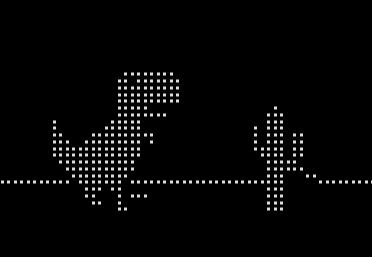

# 🦖 T-Rex-C: Your Dino Run, But in the Terminal! 🏃‍♂️


Ever been stuck without internet and played that awesome T-Rex game in Chrome? Well, guess what? Now you can relive that glory right in your terminal, thanks to this cool project written in C! It's super simple, super retro, and totally addictive.

---

## 🌟 What's Inside?

* **Old-school Terminal Fun**: Get ready for some sweet ASCII-ish graphics.
* **Resizes with Your Terminal**: No weird stretching! It just adapts.
* **Dino Jumps, Obstacles Appear**: Your trusty dino, pesky enemies, and even some fluffy clouds.
* **High Score Chasing**: See how long you can survive!
* **Day & Night Cycle**: Watch the sun and moon do their thing while you play.

## 🛠️ What You Need to Play
* **Operating System**: If you're on Linux or macOS (basically, anything Unix-y), you're golden.
* **Stuff Under the Hood**: It uses standard C libraries and some terminal magic (`ioctl`, `unistd.h`).
* **Compiler**: Make sure you have `gcc` or `clang` installed.

## 🚀 Get Started!
### For Arch Linux folks (the easy way!):
```bash
yay -S trex-c
```

### Or, if you're feeling hands-on (from the source!):
1. Grab the code:
    ```bash
    git clone https://github.com/StiveMan1/T-RexC.git
    cd T-RexC
    ```

2. Compile it up:
    ```bash
    gcc trex-c.c -O3 -lm -o trex-c
    ```

3. Run the show!
    ```bash
    ./trex-c
    ```

## 🎮 How to Play

It's super straightforward. Just open your terminal, run the game, and use these keys:

- **Space bar / Up Arrow**: Jump! Also, kicks off the game.
- **Arrow Up**: Jump and Start game
- **R**: Game over? Hit 'R' to restart in spectator mode and watch the world go by.

## 🕹️ Gameplay Lowdown

Your mission: **Dodge stuff!** Seriously, just jump over those obstacles and keep your dino alive. Your score goes up the longer you last, so aim for that high score! Keep an eye on the changing day and night – it adds a nice touch to your endless run.

## ⚙️ Tweak It (Kind of!)

While it's a simple game, a few things adjust automatically:

- **Screen Size**: It'll fit your terminal window like a glove.
- **Score**: Always chilling in the top corner.
- **World**: Dynamic day/night, clouds, sun, moon – the whole shebang!

All contributions are welcome! Please follow the coding style found in the existing code and add comments where necessary.

## 📝 License
This project is open source and licensed under the [GNU License](LICENSE). Check out the LICENSE file for all the nitty-gritty details.
